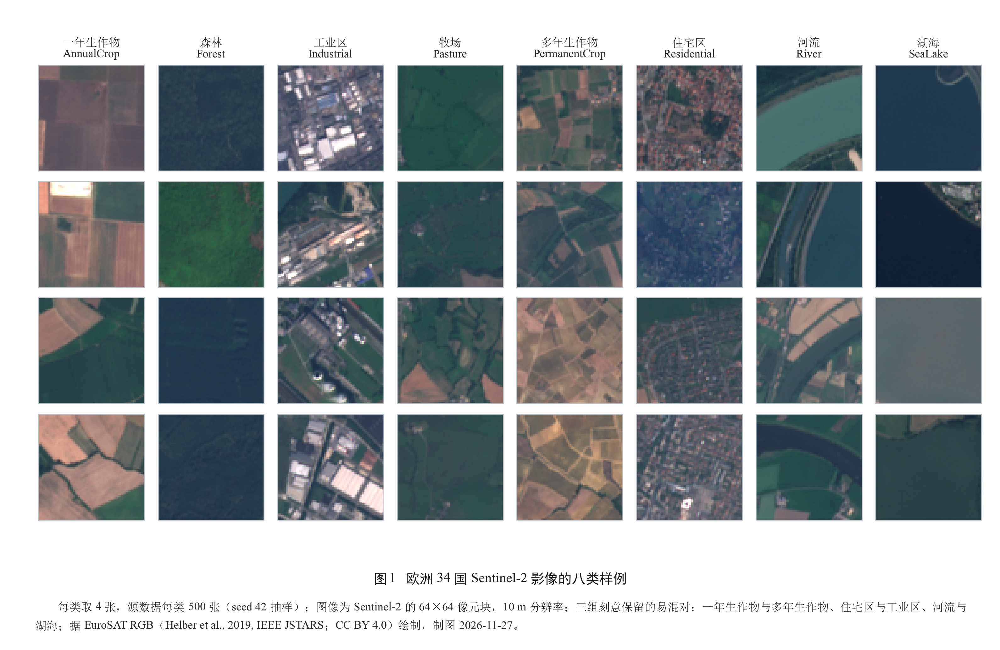
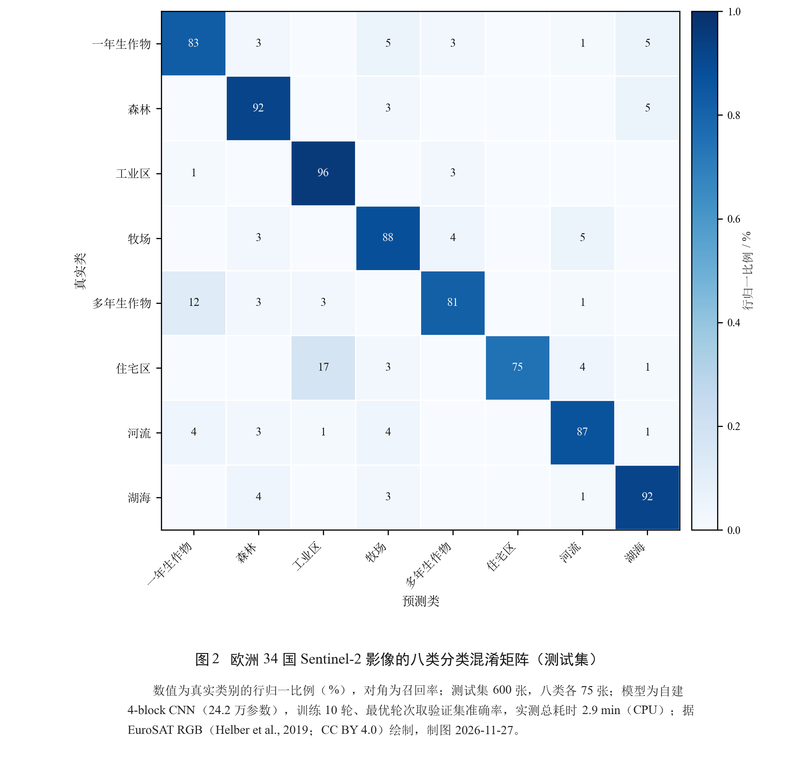
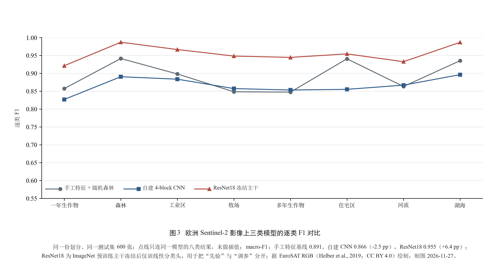
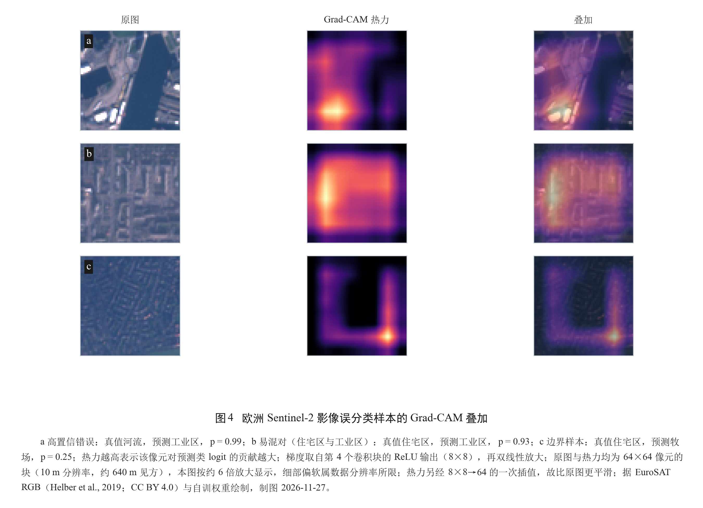

# landuse-cnn：EuroSAT RGB 八类地块影像分类

数据为 EuroSAT RGB（Helber et al., 2019, IEEE JSTARS；CC BY 4.0）：欧洲 34 国 Sentinel-2 影像，64×64 像元、10 m 分辨率；本仓库取 8 类、每类 500 张，共 4 000 张。

测试集（600 张，每类 75 张）macro-F1：手工特征 + 随机森林 0.891，自建 4-block CNN 0.866，ResNet18 冻结主干 0.955；对应总体准确率 0.892、0.867、0.955。自建 CNN 低于基线 2.5 pp，ResNet18 高于基线 6.4 pp。

## 一、项目组成

1. 数据子集：8 类地表覆盖各 500 张（`data/eurosat_subset/`）。其中三组在 10 m 尺度上视觉相近：一年生作物与多年生作物、住宅区与工业区、河流与湖海。
2. 三个模型共用同一测试集：
   - 手工特征 + 随机森林：HSV 三通道各 16 bin（48 维）+ GLCM（32 灰度级、距离 1、4 方向、contrast / homogeneity / energy，12 维），共 60 维；`RandomForest(200, random_state=42)`；
   - 自建 4-block CNN：242 216 参数，10 轮、lr 5e-4、batch 64，CPU 训练 176.7 s；
   - ResNet18：ImageNet 预训练、主干冻结，512 维特征 + 线性分类头。
3. 划分：70 / 15 / 15 分层抽样，seed 42，写入 `build/splits.csv`，三套实验共用一份，重跑结果不变。
4. 图件：样例网格、行归一混淆矩阵、逐类 F1 对比、三例 Grad-CAM（`docs/fig_*.png`）。
5. 文档：`docs/data_manifest.md`（数据口径与已知失真）、`docs/model_card.md`（模型卡、局限、不可用途声明）、`docs/复盘-W12.md`（实测耗时与计划偏差）。

## 二、指标口径

1. 基线先行：以手工特征 + 随机森林为参照，CNN 的差值按测试集 macro-F1 的百分点（pp）报。
2. 按类报：macro-F1、逐类 F1、Cohen's κ 与行归一混淆矩阵同时给出，并单列 F1 最低的两类。
3. 误差可定位：报测试集计数最多的三对混淆，并用 Grad-CAM 给出误差样本的高贡献区域。

`build/pred_baseline.csv` 与 `build/pred_resnet.csv` 保留 train / val / test 全部 4 000 行预测（含 `split` 列）；算指标须先筛 `split == 'test'`，否则得到 0.965 与 0.988 的偏高值。

## 三、复现

```bash
pip install -r requirements.txt      # CPU-only：pip install torch torchvision --index-url https://download.pytorch.org/whl/cpu
python run_all.py                    # prepare → baseline → cnn → resnet → eval → gradcam → figures
python run_all.py --skip-train       # 复用 build/cnn_final.pt，只重算指标与图
python run_all.py --skip-figures     # 只算指标，不出图
```

训练数据随仓库分发（4 000 张 PNG，24.1 MB），clone 后无需下载即可复现。若要回到 27 000 张的原始池，按 `docs/data_manifest.md` 的镜像地址下载三份 parquet 到 `raw/`（175 MB，未入库），再执行 `prepare.py`。

## 四、设计与取舍

| 决定 | 依据 | 代价 |
|---|---|---|
| 8 类而非二分类 | 二分类混淆矩阵自由度低；本项目 8 类中有三组视觉相近类别，混淆矩阵可反映类间可分性 | 训练成本高于二分类 |
| 每类 500 张、完全平衡 | macro-F1 与总体准确率可比，避免大类主导宏观指标 | 与真实地物分布不符，总体准确率不能读作区域期望精度 |
| 不做按索引分块的空间切分 | EuroSAT patch 不含景号与坐标，按索引分组不构成空间分组 | 随机划分存在同景泄漏，跨区域泛化能力未验证 |
| 数据增强仅水平 / 垂直翻转 | patch 无固定朝向；旋转与色彩抖动会改变光谱统计，与颜色直方图基线的假设冲突 | 训练样本多样性偏低 |
| 手工特征基线先行 | 同源、同季、同传感器影像上，颜色与纹理统计已达 0.891 macro-F1，可作参照 | 特征提取 37.1 s，长于一轮 CNN 训练 |
| 增加 ResNet18 冻结主干对照 | 主干冻结、仅训线性头，可将预训练权重的作用与训练预算的影响分开 | 需下载 44.7 MB 权重 |
| 轮次取 10（原计划 ≤ 3） | 实测单轮 17–18.6 s，20 min 预算内可完成 10 轮；3 轮时验证集准确率仅 0.83 | 与计划偏差，登记于 `docs/复盘-W12.md` |

## 五、结果

测试集指标（600 张，每类 75 张）：

| 模型 | 总体准确率 | macro-F1 | κ | 最差类 F1 |
|---|---|---|---|---|
| 手工特征 + 随机森林 | 0.892 | 0.891 | 0.876 | 多年生作物 0.847 |
| 自建 4-block CNN | 0.867 | 0.866 | 0.848 | 一年生作物 0.827 |
| ResNet18 冻结主干 | 0.955 | 0.955 | 0.949 | 一年生作物 0.921 |

自建 CNN 的四组设定（同一结构、同一划分、同一测试集）：

| 轮次 | lr | 总体准确率 | macro-F1 | 训练耗时 |
|---|---|---|---|---|
| 3 | 1e-3 | 0.753 | 0.751 | 54.1 s |
| 3 | 5e-4 | 0.835 | 0.834 | 55.7 s |
| 10 | 1e-3 | 0.877 | 0.876 | 193.3 s |
| 10 | 5e-4 | 0.867 | 0.866 | 176.7 s |

交付档为上表最后一行：按验证集准确率最高的第 9 轮权重存档（验证集 0.9033）。同为 10 轮时，lr 1e-3 的测试 macro-F1 高 1.0 pp，但验证集准确率低 1.2 pp（0.8917 对 0.9033）；两组差值未做显著性检验，不足以判定设定优劣。四组设定均低于手工特征基线 0.891。

ResNet18 冻结主干 0.955，高于基线 6.4 pp；特征提取 129.7 s，线性头拟合不足 10 s。

三处最多混淆（自建 CNN，测试集计数）：住宅区→工业区 13、多年生作物→一年生作物 9、一年生作物→牧场 4；另有一年生作物→湖海、森林→湖海各 4。10 m 尺度下，厂房与低层密集住宅的屋顶纹理、道路网相近；多年生与一年生作物同为规则田块，差异仅在排列与色调。

Grad-CAM 三例的贡献峰值位置：a（河流→工业区，p=0.99）在岸边护岸与码头（[19,51]），不在水面；b（住宅区→工业区，p=0.93）在住区边缘（[12,35]）；c（住宅区→牧场，p=0.25）在画面右下角空地（[51,51]）。前两例中贡献区域与目标地物不重合，可用于说明高置信预测与关注区域无必然对应。

## 六、局限

1. 随机划分存在同景泄漏：EuroSAT patch 无景号与坐标，相邻 patch 会同时进入训练与测试，测试分数不含跨区域泛化信息。
2. 类别人为平衡：每类 500 张，与真实分布不符，总体准确率不能读作区域期望精度。
3. 分辨率为 64×64 像元（10 m）：单栋厂房、小路、堤岸不可辨，住宅区与工业区的混淆与该尺度直接相关。
4. 未系统调参：只比较 3 / 10 轮与两个学习率共四组设定，未做学习率衰减、标签平滑、MixUp 等常规手段；0.866 是该预算与设定下的结果，未验证为该结构上限。
5. 仅用 RGB 三波段：近红外与短波红外未使用，河流与牧场等光谱可分性更强的类别未做进一步区分。

## 七、用途限制

不可用于执法、违建认定、土地督察等具有法律后果的场景；不可用于规划审批与用地性质裁定；不可用于面积统计与耕地占补平衡核算（模型输出为 patch 级类别标签，无地块边界，未经面积精度检验）；不可外推为欧洲以外任何区域的地块分类能力。

需要落地到具体行政区时，须先用该区域的标注样本重训，并做空间分组验证后逐类报精度。


<sub>图 1　欧洲 34 国 Sentinel-2 影像的八类样例</sub>


<sub>图 2　欧洲 34 国 Sentinel-2 影像的八类分类混淆矩阵（测试集）</sub>


<sub>图 3　欧洲 Sentinel-2 影像上三类模型的逐类 F1 对比</sub>


<sub>图 4　欧洲 Sentinel-2 影像误分类样本的 Grad-CAM 叠加</sub>

## 八、English Summary

A reproducible 8-class land-cover classification experiment on EuroSAT RGB (Helber et al., 2019; CC BY 4.0):
4 000 patches (8 classes × 500, 64×64 pixels at 10 m), one fixed stratified 70/15/15 split (seed 42) shared by all experiments.

Test-set results (600 patches, 75 per class), macro-F1: random forest on hand-crafted features (HSV histograms + GLCM, 60 dims) 0.891; 4-block CNN trained from scratch (242 216 parameters, 2.9 min on CPU) 0.866; frozen ImageNet ResNet18 with a linear head 0.955. Four CNN settings (3 or 10 epochs × lr 1e-3/5e-4) are tabulated; none reaches the hand-crafted baseline.

The repository ships per-class F1, a row-normalised confusion matrix, three Grad-CAM overlays of misclassified patches, a data manifest, a model card stating the training budget, five limitations and the prohibited uses, and a one-command reproduction script.
